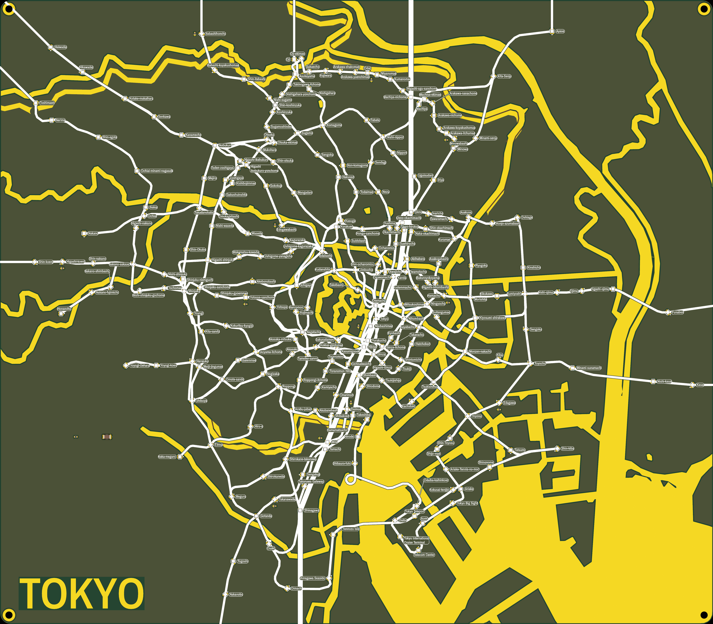

# tokyo-metro-pcb

A printed circuit board that is a map of the Tokyo subway, with one
addressable RGB LED per station: Tokyo Metro's nine lines and Toei's four,
the two extensions under construction, the JR Yamanote loop, the Toden
Arakawa tram, the Yurikamome, the Rinkai line and the Shinkansen —
**248 stations, 248 LEDs**, on a 320 × 280 mm board.

The third board in the series, ported from the
[Montréal Métro PCB](https://github.com/funvill/montreal-skytrain-pcb), which
came from the
[Vancouver SkyTrain PCB](https://github.com/funvill/vancouver-skytrain-pcb).

The map is **organic**: every station stands where the city puts it (mean
error 6 m) and the track follows the real rails from OpenStreetMap, bridges
and tunnels included — the Rainbow Bridge with its Shibaura spiral, the
1,236 m Arakawa truss, the Tokyo Port Tunnel. Station names sit in capsules
that knock the route out behind them, so a name may lie across a line and
still read.

**Status: the map is finished, and the KiCad board is built from it —
placement, outline and artwork. Nothing is routed yet.**



*The KiCad board, rendered by `kicad-cli`. Not a preview: this is the
artwork as it would be plotted.*

## Where things are

| Folder | What |
|---|---|
| [`input/tokyo.json`](input/) | **The board.** Stations, lines, label placements, chain, water, wordmark |
| [`input/`](input/) | The builders, the Overpass queries, and the hand-made data |
| [`input/osm/`](input/osm/) | Raw Overpass responses, committed so builds run offline |
| [`fonts/`](fonts/) | Archivo Narrow SemiBold, the label face, SIL OFL |
| [`tools/`](tools/) | The pipeline: layout, labels, chain, checks, previews, fab outputs |
| [`hardware/`](hardware/) | KiCad 10 footprint and symbol libraries; the board is not built yet |
| [`firmware/`](firmware/) | XIAO firmware; the line table is generated from the data |
| [`docs/decisions.md`](docs/decisions.md) | Scope, board, labels, power, controller |
| [`docs/styles.md`](docs/styles.md) | The eight map styles considered, and everything settled since |
| [`runbook-new-city.md`](runbook-new-city.md) | The phase-by-phase process |
| [`lessons-learned.md`](lessons-learned.md) | Part D is this board; Part C is the pre-order checklist |

## Rebuilding the map

```bash
cd input && ./rebuild.sh
```

One command, from the cached Overpass responses to `tokyo.json` and the
previews. Every intermediate is disposable and none is kept.

Hand work is **not** regenerated: `label_overrides.json` (248 label
placements) and `chain.json` (the LED order) are re-applied on every build,
and the only way to change them is `import_labels.py` or `build_chain.py`,
deliberately (lesson B5).

| Step | Tool |
|---|---|
| Station list from OSM, cross-checked against the official station codes | `input/build_station_latlon.py` |
| Octolinear layout, land fitted rigidly, water, wordmark | `input/build_tokyo.py` |
| Move the board edge in without redrawing the map | `tools/crop_board.py` |
| Label placement | `tools/auto_label.py`, `tools/check_fit.py` |
| LED chain order | `tools/build_chain.py` |
| What the board will etch | `tools/preview_map.py` |
| Firmware line table | `tools/make_firmware_lines.py` |

## The board

| | |
|---|---|
| Size | 320 × 280 mm, 2 layers, ENIG |
| LEDs | 248 XL-1615 WS2812B, one per station |
| Lines | 18, drawn in 0.75 mm white silkscreen on their real alignment; the Shinkansen at 2.2× |
| Water | Bare ENIG copper, land placed rigidly at 14.4 mm/km, north up; no station's clearance disc notches it |
| Labels | English names, 1.1 mm, Archivo Narrow SemiBold **embedded in the board**, each in a knockout capsule; 242 of 248 plain horizontal, none rotated |
| Power | A USB-C input of its own, plus a 2-pin Phoenix Contact terminal block on a cuttable link |
| Controller | Seeed XIAO RP2040, hand-soldered at a board edge |

## Known, going into routing

- **67 LEDs sit in a hole cut out of the water**, so the front ground pour
  will be cut into islands and each of them needs its own via to the back
  plane. Script the island count; do not eyeball it (lesson A5, Part C.5).
- **38 chain hops cross bare-copper water**, 174 mm in total. None can run
  on the front.
- **25 label collisions remain** in the core, all but two white-on-white
  text over a route. They are hand work in KiCad, then frozen with
  `import_labels.py`.
- **248 LEDs is about 15 A at full white.** The firmware cap stays at
  900 mA until the supply and the injection points are proven.

## Still to do

1. Route by hand. Before starting: **67 LEDs sit in a hole cut out of the
   bare-copper water**, so the front pour is in islands and each needs its
   own via to the back plane; and **38 chain hops cross water**, which
   cannot be routed on the front.
2. Clear the DRC that is left: 2 shorts where mounting holes fall in the
   bay, 28 isolated copper islands, 16 starved thermals. The 11 "silkscreen
   clipped by board edge" warnings are the line stubs running off the edge
   on purpose, and the fab trims them.
3. The Part C checklist before ordering.
